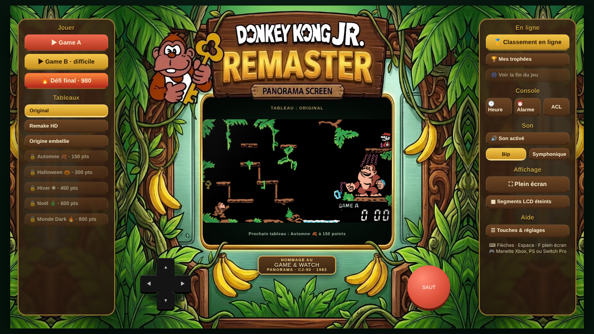
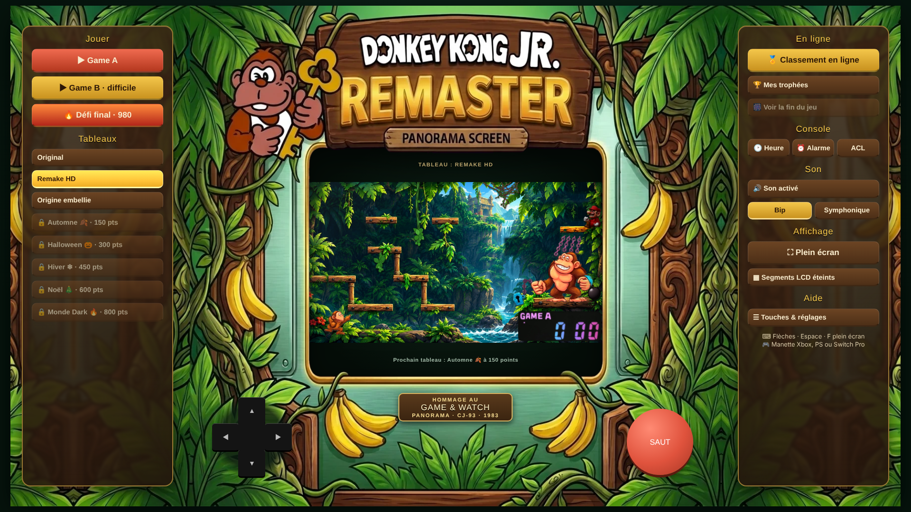
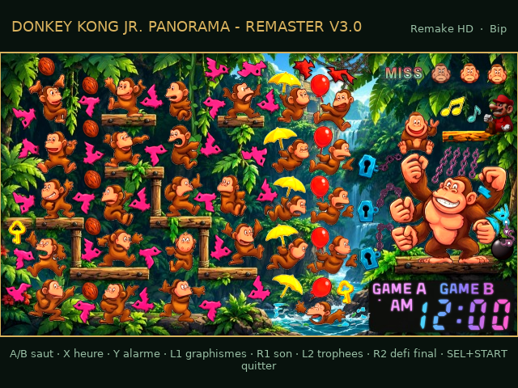

# 🐒 Donkey Kong Jr. Panorama — Remaster

> Un remaster fait par un fan du Game & Watch **Donkey Kong Jr. Panorama Screen** (CJ-93, 1983).
> On y joue sur **PC**, sur **console portable Anbernic** et sur **Nintendo Switch** (homebrew).

**▶ Jouer en ligne : [https://darkchris02320-pixel.github.io/dkjr-panorama-remaster/](https://darkchris02320-pixel.github.io/dkjr-panorama-remaster/)** (version PC, rien à installer)

---

## ❤️ Pourquoi ce projet

Je joue à ce jeu depuis l'âge de **5 ans**. C'est **le tout premier jeu vidéo** auquel j'ai joué.

Chez nous, le Donkey Kong Jr. Panorama passait de main en main : mes cousins, mon frère, mon père et même mon grand-père. On y jouait parfois jusqu'à 3 h du matin, à se battre pour le meilleur score.

Ce remaster, c'est ma façon de rendre hommage à ces soirées en famille : garder **exactement le jeu de notre enfance**, et lui donner ce qu'il n'a jamais eu. De nouveaux décors, des trophées, un classement entre amis… et **une vraie fin**.

---

## 📥 Téléchargements

| Version | Fichier | Notice |
|---|---|---|
| 💻 **PC** (Windows, Mac, Linux — navigateur) | [DKJr-Panorama-Remaster-V4.1-PC.zip](telechargements/DKJr-Panorama-Remaster-V4.1-PC.zip) | [Notice PC](notices/NOTICE-PC.md) |
| 🎮 **Anbernic RG35XXSP** (et consoles PortMaster) | [DKJr-Panorama-Remaster-V3.0-Anbernic-RG35XXSP.zip](telechargements/DKJr-Panorama-Remaster-V3.0-Anbernic-RG35XXSP.zip) | [Notice Anbernic](notices/NOTICE-ANBERNIC.md) |
| 🕹️ **Nintendo Switch** (homebrew .nro) | [DKJr-Panorama-Remaster-V3.0-Switch.zip](telechargements/DKJr-Panorama-Remaster-V3.0-Switch.zip) | [Notice Switch](notices/NOTICE-SWITCH.md) |

Pour télécharger un fichier : clique dessus, puis sur le bouton **Download** (ou l'icône ⬇) à droite.

---

## 💾 ROM d'origine (non fournie)

Le jeu n'a pas été « refait de mémoire » : c'est le **programme d'origine de la console** qui tourne, grâce à l'émulation de son processeur (Sharp SM511). Le gameplay est donc identique à la vraie console : même vitesse, mêmes pièges, même son.

Ce programme appartient à Nintendo, il **n'est pas fourni ici**. Il te faut l'un des deux :

- le fichier **`gnw_dkjrp.zip`** (jeu MAME « Donkey Kong Jr. (panorama screen) ») ;
- ou les deux fichiers qu'il contient : **`cj-93.program`** et **`cj-93.melody`**.

Chaque version te dit où le mettre (voir les notices). Sur PC, le jeu le demande au premier lancement puis s'en souvient.

---

## 🎨 8 tableaux à débloquer

| Tableau | Déblocage |
|---|---|
| Original (écran LCD d'époque) | dès le départ |
| Remake HD | dès le départ |
| Origine embellie | dès le départ |
| 🍂 Automne | 150 points |
| 🎃 Halloween | 300 points |
| ❄️ Hiver | 450 points |
| 🎄 Noël | 600 points |
| 🔥 Monde Dark (lave, braises, jeu accéléré) | 800 points |

🔊 Deux ambiances sonores : le **bip original** ou une version **symphonique HD** qui joue la mélodie note pour note.

## 🏆 31 trophées

Des trophées faciles, moyens, difficiles… et un trophée secret. Et il y a un **code secret** pour tout débloquer… à vous de le trouver 😉

## 🌍 Classement en ligne

À la fin de chaque partie, un **QR code** s'affiche avec ton score. Sur PC, tu tapes ton pseudo ; sur console, tu scannes le QR code avec ton téléphone. Le classement montre le meilleur score de chaque joueur, toutes les parties avec la date, et les trophées de chacun.

## 🎆 Une vraie fin

Le Game & Watch d'origine n'avait pas de fin. Ici, dans le **Monde Dark**, atteins **980 points**, récupère le **lance-pierre** puis attrape un **parapluie**… et regarde la fin en bande dessinée.

---

## 📸 Captures

| PC | Anbernic |
|---|---|
|  |  |

---

## ⚖️ Avertissement

Projet de fan, gratuit et sans but commercial, fait par passion et pour un usage personnel.
Il n'est ni affilié à Nintendo, ni approuvé par Nintendo.
*Donkey Kong*, *Donkey Kong Jr.*, *Game & Watch* et *Nintendo Switch* sont des marques de Nintendo.
La ROM d'origine n'est pas distribuée ici.
